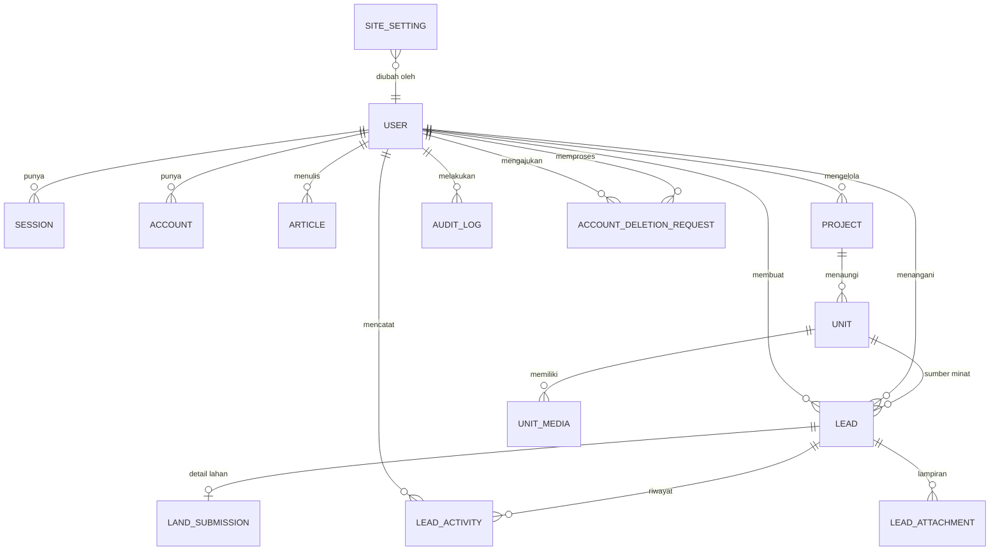

# 04 — Model Data & Skema Prisma

> Kembali ke [index](./README.md) · Sebelumnya: [03](./03-arsitektur-teknis.md) · Berikutnya: [05](./05-spesifikasi-api.md)

---

## 1. Prinsip pemodelan

1. **Lead adalah pusat data.** Dua aliran yang menghasilkan lead (pembelian unit dan penawaran lahan) bermuara ke satu tabel `Lead`, dengan tabel detail terpisah untuk `LandSubmission`. Ini membuat antrean sales tunggal dan pelaporan lintas aliran. Halaman investasi tidak menghasilkan lead.
2. **Soft delete untuk konten.** Unit rumah dan artikel yang sudah tayang tidak dihapus fisik; gunakan `publishStatus = ARCHIVED` + `deletedAt`.
3. **Data pribadi seminimal mungkin.** Hanya field yang benar-benar dipakai sales. Tidak ada NIK, nomor kartu, atau dokumen identitas pada MVP.
4. **Semua waktu dalam UTC**, ditampilkan dalam `Asia/Jakarta`.
5. **Uang dalam rupiah utuh** (`BigInt`), tanpa desimal. Serialisasi API: string (lihat [05 §2.4](./05-spesifikasi-api.md#24-tipe-data-khusus)).
6. **Konten kaya disimpan sebagai HTML tersanitasi.** Editor admin memakai Tiptap; API menyimpan HTML setelah disanitasi ber-allowlist (D8). Markdown tidak dipakai.
7. **Strategi ID.** `Int autoincrement` untuk entitas internal yang tidak diekspos; `nanoid()` untuk ID unik yang dikembalikan ke pengguna; **UUIDv7** untuk entitas yang butuh urutan waktu sekaligus tidak mudah ditebak. Tabel Better Auth memakai ID yang dibuat Better Auth, bukan default Prisma.

| Kebutuhan | Tipe ID | Contoh model |
|-----------|---------|--------------|
| Urut, internal, tidak diekspos | `Int @id @default(autoincrement())` | `Unit`, `Project`, `Article`, `LeadActivity`, `AuditLog`, `FunnelEvent` |
| Unik, dikembalikan ke pengguna | `String @id @default(nanoid())` | `AccountDeletionRequest` |
| Urut waktu + acak (tidak mudah ditebak) | `String @id @default(uuid(7)) @db.Uuid` | `Lead` |
| Dikelola Better Auth | `String @id` tanpa default; `generateId` → `nanoid()` | `User`, `Session`, `Account`, `Verification` |

## 2. ERD



Relasi `Lead ↔ User` ada dua (pemilik akun dan penanggung jawab), karenanya memakai nama relasi eksplisit di Prisma.

## 3. Kamus data inti

### 3.1 `Lead`

| Kolom | Tipe | Null | Default | Keterangan |
|-------|------|:----:|---------|------------|
| `id` | uuid | ✗ | uuid v7 | PK |
| `reference` | text | ✗ | — | Nomor manusiawi, mis. `AZT-LD-2610-A7K2Q`. Unik |
| `type` | enum | ✗ | — | `BUY_UNIT` / `LAND_OFFER` / `GENERAL` |
| `status` | enum | ✗ | `NEW` | Lihat [§3.6](#36-pipeline-status) |
| `priority` | enum | ✗ | `NORMAL` | `LOW`/`NORMAL`/`HIGH`/`URGENT` |
| `name` | text | ✗ | — | 2–80 karakter |
| `phone` | text | ✗ | — | Dinormalisasi `+62…` |
| `phoneNormalized` | text | ✗ | — | Digit saja (`62812…`), dipakai untuk deduplikasi |
| `email` | text | ✓ | — | Opsional; dipakai untuk menautkan pengajuan ke akun |
| `city` | text | ✓ | — | Kota pemohon (bukan selalu lokasi lahan) |
| `message` | text | ✓ | — | Maks 1000 karakter |
| `unitId` | int | ✓ | — | Terisi untuk `BUY_UNIT` |
| `source` | enum | ✗ | `WEBSITE` | Kanal asal |
| `landingPath` | text | ✓ | — | Path halaman saat submit |
| `referrerUrl` | text | ✓ | — | Referrer (di-truncate 500 char) |
| `utmSource` … `utmTerm` | text | ✓ | — | Atribusi kampanye |
| `ipHash` | text | ✓ | — | SHA-256(IP + salt), untuk anti-abuse. **Bukan** IP mentah |
| `userAgent` | text | ✓ | — | Maks 300 char |
| `userId` | text | ✓ | — | Pemilik akun; wajib agar pengajuan tampil di `/akun` |
| `assignedToId` | text | ✓ | — | Staf penanggung jawab |
| `estimatedValue` | bigint | ✓ | — | Estimasi nilai deal (diisi sales) |
| `lostReason` | text | ✓ | — | Wajib saat status `LOST` |
| `firstContactedAt` | timestamptz | ✓ | — | Diisi otomatis saat status pertama kali ≥ `CONTACTED` |
| `lastContactedAt` | timestamptz | ✓ | — | Dari aktivitas tipe kontak |
| `nextFollowUpAt` | timestamptz | ✓ | — | Pengingat manual |
| `closedAt` | timestamptz | ✓ | — | Saat `WON`/`LOST` |
| `spamScore` | int | ✗ | 0 | Akumulasi sinyal (honeypot=100, waktu isi < 3 s=40, dsb.) |
| `idempotencyKey` | text | ✓ | — | Unik; mencegah duplikat saat submit diulang (lihat [05 §2.5](./05-spesifikasi-api.md#25-idempotensi--deduplikasi)) |
| `customerNote` | text | ✓ | — | Catatan untuk pemohon, tampil di `/akun` (bukan catatan internal) |
| `customerNoteUpdatedAt` | timestamptz | ✓ | — | Kapan catatan terakhir diperbarui |
| `createdAt` / `updatedAt` | timestamptz | ✗ | now | — |

**Index:** `(status, createdAt)`, `(type, status)`, `(assignedToId, status)`, `(phoneNormalized)`, `(createdAt)`, `(unitId)`.

### 3.2 `LandSubmission` (1:1 dengan Lead)

| Kolom | Tipe | Null | Keterangan |
|-------|------|:----:|------------|
| `id` | int | ✗ | PK (autoincrement) |
| `leadId` | uuid | ✗ | Unik, FK ke `Lead` |
| `address` | text | ✗ | Alamat lengkap (10–300) |
| `province` / `city` / `district` | text | ✗/✗/✓ | Wilayah |
| `areaM2` | int | ✗ | 50–1.000.000 |
| `frontageM` | int | ✓ | Lebar depan (meter) |
| `ownershipStatus` | enum | ✗ | `SHM`/`SHGB`/`AJB`/`GIRIK`/`LETTER_C`/`OTHER` |
| `certificateOnBehalf` | text | ✓ | Atas nama siapa |
| `zoning` | text | ✓ | Peruntukan (perumahan, komersial, dll.) |
| `currentUse` | text | ✓ | Kondisi saat ini (kosong, bangunan, sawah) |
| `roadAccess` | text | ✓ | Lebar jalan/akses |
| `estimatedValue` | bigint | ✓ | Perkiraan harga lahan |
| `offerIntent` | enum | ✗ | Maksud penawaran: `SALE` (dijual ke Azetta) / `PARTNERSHIP` (dikerjasamakan) / `UNKNOWN` |
| `startTimeline` | enum | ✓ | `IMMEDIATE`/`M3_6`/`M6_12`/`OVER_12`/`UNKNOWN` — kesiapan pemilik lahan |
| `notes` | text | ✓ | Maks 1000 |

### 3.3 `Unit`

Unit rumah yang dijual. Selalu terikat pada satu `Project` (lihat [§3.6](#36-project)). **Desain bukan entitas produk**: render dan denah disimpan sebagai media unit.

| Kolom | Tipe | Null | Keterangan |
|-------|------|:----:|------------|
| `id` | int | ✗ | PK (autoincrement) |
| `projectId` | int | ✗ | FK ke `Project`; unit tidak dapat dipublikasikan bila proyeknya belum publish |
| `slug` | text | ✗ | Unik, `kebab-case`, 3–100; dipakai di `/rumah/[slug]` |
| `unitCode` | text | ✗ | Kode unit, mis. `A1`, `B12`; unik per proyek |
| `typeName` | text | ✗ | Nama tipe, mis. `Tipe 45`, `Tipe 60`; dasar tampilan harga "mulai dari" |
| `title` | text | ✗ | 5–120, mis. `Azetta Residence Tipe 45` |
| `subtitle` | text | ✓ | Maks 160 |
| `description` | text | ✗ | HTML tersanitasi (Tiptap), maks 10.000 karakter |
| `floors` | int | ✗ | 1–3 |
| `bedrooms` | int | ✗ | 0–10 |
| `bathrooms` | int | ✗ | 0–10 |
| `carports` | int | ✗ | 0–5 |
| `buildingAreaM2` | int | ✗ | 20–2.000 |
| `landAreaM2` | int | ✗ | 20–10.000 |
| `priceFrom` | bigint | ✓ | Harga indikatif "mulai dari" untuk tipe ini; kosong → "Hubungi kami" |
| `publishStatus` | enum | ✗ | `DRAFT`/`PUBLISHED`/`ARCHIVED` |
| `salesStatus` | enum | ✗ | `AVAILABLE`/`INDENT`/`SOLD` — terpisah dari status publish |
| `featured` | bool | ✗ | Tampil di beranda |
| `viewCount` | int | ✗ | 0 |
| `publishedAt` | timestamptz | ✓ | Diisi saat publish |
| `seoTitle` / `seoDescription` | text | ✓ | Fallback ke `title`/`subtitle` |
| `deletedAt` | timestamptz | ✓ | Soft delete |

**Aturan:**

- `salesStatus` **tidak** mengubah `publishStatus`. Unit `SOLD` tetap tayang (badge "Terjual") agar tautan lama tidak mati dan unit sejenis bisa ditawarkan.
- Harga disimpan per unit karena tipe yang sama dapat memiliki harga berbeda antar-tahap pembangunan; tampilan publik tetap memakai label "mulai dari" dan mengambil nilai terendah di antara unit `AVAILABLE` pada proyek yang sama.
- Kombinasi `(projectId, unitCode)` unik.

### 3.3a `UnitMedia`

| Kolom | Tipe | Null | Keterangan |
|-------|------|:----:|------------|
| `id` | int | ✗ | PK (autoincrement) |
| `unitId` | int | ✗ | FK ke `Unit`, cascade delete |
| `kind` | enum | ✗ | `RENDER`/`FLOOR_PLAN`/`PHOTO`/`SITE_PLAN`/`VIDEO` |
| `storageKey` / `url` | text | ✗ | Objek R2/S3 + URL CDN |
| `alt` | text | ✓ | Wajib untuk gambar yang bermakna (aksesibilitas) |
| `width` / `height` | int | ✓ | Piksel |
| `sortOrder` | int | ✗ | 0 |
| `isCover` | bool | ✗ | Satu cover per unit (ditegakkan di service) |

> Render = visual akhir yang ditampilkan ke pembeli dan akan disepakati sebelum pembangunan; secara data ia hanya media unit, bukan produk terpisah.

### 3.4 `Article`, `Faq`, `Testimonial`, `SiteSetting`

| Entitas | Field kunci |
|---------|-------------|
| `Article` | `slug`, `title`, `excerpt`, `content` (HTML tersanitasi), `coverImageUrl`, `authorId`, `status`, `publishedAt`, `readingMinutes`, `tags text[]`, `viewCount`, `seoTitle`, `seoDescription`, `deletedAt` |
| `Faq` | `question`, `answer`, `category`, `sortOrder`, `isActive` |
| `Testimonial` | `name`, `role`, `projectName`, `quote`, `avatarUrl`, `isPublished`, `sortOrder` |
| `SiteSetting` | `key` (PK), `value` (JSONB), `updatedById`, `updatedAt` |

Kunci `SiteSetting` yang dipakai MVP:

| Key | Isi |
|-----|-----|
| `contact` | `{ phone, whatsapp, email, address, mapsUrl, operatingHours }` |
| `brand` | `{ logoUrl, faviconUrl, legalName }` — warna tetap mengikuti Brand Guidelines (monokrom), tidak dapat diubah dari admin |
| `hero` | `{ title, subtitle, ctaLabel, ctaHref, imageUrl }` |
| `offer.land` | `{ headline, schemeBullets[], steps[], faqs[] }` |
| `offer.invest` | `{ headline, highlights[], riskNotes[], faqs[] }` |
| `about` | `{ story, vision, values[], team[], legalEntityNote }` |
| `legal` | `{ privacyUpdatedAt, termsUpdatedAt, documents: [{ label, url, uploadedAt }] }` |
| `wa.templates` | `{ unit, land, followUp }` |
| `analytics` | `{ ga4Id, umamiId, metaPixelId }` |
| `seo.default` | `{ titleTemplate, defaultDescription, ogImageUrl }` |

Key `brand` dan `legal` menyimpan URL hasil unggah melalui presign (gambar/PDF) — halaman Pengaturan menyediakan unggah, ganti, dan hapus. Ini memungkinkan dokumen legal ditambahkan kapan pun tanpa deploy (Q10).

### 3.5 Pipeline status

```text
NEW ──► CONTACTED ──► QUALIFIED ──► PROPOSAL ──► NEGOTIATION ──► WON
 │           │             │             │             │
 └───────────┴─────────────┴─────────────┴─────────────┴──────► LOST
 (dari status mana pun kecuali WON/LOST)

SPAM: hanya dari NEW atau CONTACTED, oleh admin
```

Transisi yang diizinkan (divalidasi server):

| Dari | Ke |
|------|-----|
| `NEW` | `CONTACTED`, `LOST`, `SPAM` |
| `CONTACTED` | `QUALIFIED`, `LOST`, `SPAM` |
| `QUALIFIED` | `PROPOSAL`, `LOST` |
| `PROPOSAL` | `NEGOTIATION`, `QUALIFIED`, `WON`, `LOST` |
| `NEGOTIATION` | `WON`, `LOST` |
| `WON` | — (final) |
| `LOST` | `NEW` (reaktivasi, tercatat di aktivitas) |
| `SPAM` | `NEW` (bila salah klasifikasi) |

**Pemetaan ke status yang dilihat pemohon** (dihitung saat runtime, tidak disimpan):

| Status internal | Label di `/akun` | Warna |
|-----------------|------------------|-------|
| `NEW` | Diterima | netral |
| `CONTACTED` | Sedang dihubungi | info |
| `QUALIFIED` | Sedang ditinjau | info |
| `PROPOSAL` | Penawaran disiapkan | info |
| `NEGOTIATION` | Dalam diskusi | perhatian |
| `WON` | Selesai | sukses |
| `LOST` | Ditutup | netral |
| `SPAM` | *tidak ditampilkan* | — |

### 3.6 Project

Proyek perumahan yang dikembangkan Azetta. Menjadi induk `Unit` dan tampil sebagai portofolio di `/proyek` (Q4). Tidak memiliki relasi langsung ke `Lead` pada MVP — atribusi tetap lewat `landingPath`.

| Kolom | Tipe | Null | Keterangan |
|-------|------|:----:|------------|
| `id` | int | ✗ | PK (autoincrement) |
| `slug` | text | ✗ | Unik, `kebab-case` |
| `title` | text | ✗ | 5–120 |
| `summary` | text | ✓ | Ringkasan 1–2 kalimat (kartu & meta) |
| `description` | text | ✓ | HTML tersanitasi (Tiptap), maks 10.000 karakter |
| `location` | text | ✗ | Nama lokasi yang aman dipublikasikan |
| `city` / `province` | text | ✗/✗ | Untuk filter & SEO |
| `status` | enum | ✗ | `PLANNED` / `ONGOING` / `COMPLETED` |
| `yearStarted` / `yearCompleted` | int | ✓ | 2000–2100 |
| `landAreaM2` | int | ✓ | Opsional |
| `unitCount` | int | ✓ | Opsional; angka pemasaran. Jumlah unit sebenarnya dihitung dari relasi `Unit` |
| `coverImageUrl` | text | ✓ | Wajib sebelum publish |
| `galleryUrls` | text[] | ✗ | 0–10 URL, urutan dipertahankan |
| `isPublished` | bool | ✗ | Default `false` |
| `sortOrder` | int | ✗ | 0 |
| `seoTitle` / `seoDescription` | text | ✓ | — |
| `createdById` | text | ✓ | Admin pembuat |
| `createdAt` / `updatedAt` / `deletedAt` | timestamptz | ✗/✗/✓ | — |

> Galeri memakai array URL (bukan tabel media terpisah) karena portofolio jarang berubah dan tidak memerlukan `alt` per gambar di MVP. Bila kebutuhan ini tumbuh, migrasi ke tabel media dapat dilakukan tanpa mengubah URL publik.

### 3.7 `AccountDeletionRequest`

Permohonan hapus akun (Q12). Pemohon hanya **mengajukan**; admin memutuskan dan menghapus/menganonimkan data di luar sistem pada MVP.

| Kolom | Tipe | Null | Default | Keterangan |
|-------|------|:----:|---------|------------|
| `id` | text | ✗ | nanoid | PK |
| `userId` | text | ✗ | — | Pemohon |
| `reason` | text | ✓ | — | Alasan, maks 500 karakter |
| `status` | enum | ✗ | `PENDING` | `PENDING` / `COMPLETED` / `REJECTED` |
| `requestedAt` | timestamptz | ✗ | now | Waktu pengajuan |
| `handledAt` | timestamptz | ✓ | — | Waktu admin menandai selesai/ditolak |
| `handledById` | text | ✓ | — | Admin pemroses |
| `note` | text | ✓ | — | Catatan internal admin |

> MVP: maksimal **satu permohonan `PENDING` per akun** (ditegakkan di service). Tidak ada penghapusan otomatis; setelah data diproses manual, admin menandai `COMPLETED`. Detail mekanisme penghapusan dicatat sebagai Q12a di [12 §2](./12-risiko-asumsi-keputusan.md#2-keputusan-atas-pertanyaan-terbuka).

## 4. Skema Prisma lengkap

> **Prisma 7.** Sejak v7, `url` tidak lagi ditulis di blok `datasource`; URL koneksi dipindahkan ke `prisma.config.ts` dan `PrismaClient` memakai driver adapter. Bila memakai Prisma 6, tambahkan `url = env("DATABASE_URL")` di `datasource`, ubah provider generator menjadi `prisma-client-js`, dan adapter tidak diperlukan.

```ts
// packages/db/prisma.config.ts
import 'dotenv/config';
import { defineConfig, env } from 'prisma/config';

export default defineConfig({
  schema: 'prisma/schema.prisma',
  migrations: {
    path: 'prisma/migrations',
    seed: 'bun prisma/seed.ts',
  },
  datasource: {
    url: env('DATABASE_URL'),
  },
});
```

```prisma
generator client {
  provider = "prisma-client"
  output   = "../src/generated/prisma"
}

generator json {
  provider     = "prisma-json-types-generator"
  namespace    = "PrismaJson"
  allowAny     = false
  clientOutput = "../src/generated/prisma"
}

generator prismabox {
  provider                    = "prismabox"
  typeboxImportDependencyName = "elysia"
  typeboxImportVariableName   = "t"
  inputModel                  = true
  output                      = "../src/generated/prismabox"
}

datasource db {
  provider = "postgresql"
}

// ============================================================
// Better Auth
// ============================================================

model User {
  id            String    @id
  name          String
  email         String    @unique
  emailVerified Boolean   @default(false)
  image         String?
  createdAt     DateTime  @default(now())
  updatedAt     DateTime  @updatedAt

  // admin plugin
  role       String    @default("customer")
  banned     Boolean   @default(false)
  banReason  String?
  banExpires DateTime?

  // profil aplikasi
  phone       String?
  whatsapp    String?
  city        String?
  company     String?
  lastLoginAt DateTime?

  sessions      Session[]
  accounts      Account[]
  createdLeads  Lead[]           @relation("LeadCreatedBy")
  assignedLeads Lead[]           @relation("LeadAssignee")
  activities    LeadActivity[]
  attachments   LeadAttachment[] @relation("AttachmentUploader")
  articles      Article[]        @relation("ArticleAuthor")
  projects      Project[]        @relation("ProjectAuthor")
  auditLogs     AuditLog[]
  settings      SiteSetting[]    @relation("SettingUpdatedBy")

  deletionRequests        AccountDeletionRequest[] @relation("DeletionRequestedBy")
  handledDeletionRequests AccountDeletionRequest[] @relation("DeletionRequestHandledBy")

  @@index([role])
  @@map("user")
}

model Session {
  id             String   @id
  token          String   @unique
  expiresAt      DateTime
  ipAddress      String?
  userAgent      String?
  userId         String
  impersonatedBy String?
  createdAt      DateTime @default(now())
  updatedAt      DateTime @updatedAt

  user User @relation(fields: [userId], references: [id], onDelete: Cascade)

  @@index([userId])
  @@map("session")
}

model Account {
  id                    String    @id
  accountId             String
  providerId            String
  userId                String
  accessToken           String?
  refreshToken          String?
  idToken               String?
  accessTokenExpiresAt  DateTime?
  refreshTokenExpiresAt DateTime?
  scope                 String?
  password              String?
  createdAt             DateTime  @default(now())
  updatedAt             DateTime  @updatedAt

  user User @relation(fields: [userId], references: [id], onDelete: Cascade)

  @@index([userId])
  @@map("account")
}

model Verification {
  id         String   @id
  identifier String
  value      String
  expiresAt  DateTime
  createdAt  DateTime @default(now())
  updatedAt  DateTime @updatedAt

  @@index([identifier])
  @@map("verification")
}

// ============================================================
// Katalog unit rumah
// ============================================================

enum UnitPublishStatus {
  DRAFT
  PUBLISHED
  ARCHIVED
}

enum UnitSalesStatus {
  AVAILABLE
  INDENT
  SOLD
}

enum UnitMediaKind {
  RENDER
  FLOOR_PLAN
  PHOTO
  SITE_PLAN
  VIDEO
}

model Unit {
  id Int @id @default(autoincrement())
  slug        String  @unique
  unitCode    String
  typeName    String
  title       String
  subtitle    String?
  /// HTML tersanitasi (Tiptap)
  description String  @db.Text

  projectId Int
  project   Project @relation(fields: [projectId], references: [id], onDelete: Restrict)

  floors         Int @default(1)
  bedrooms       Int @default(0)
  bathrooms      Int @default(0)
  carports       Int @default(0)
  buildingAreaM2 Int
  landAreaM2     Int

  /// Harga indikatif "mulai dari" untuk tipe ini
  priceFrom BigInt?

  publishStatus UnitPublishStatus @default(DRAFT)
  salesStatus   UnitSalesStatus   @default(AVAILABLE)
  featured      Boolean           @default(false)
  viewCount     Int               @default(0)
  publishedAt   DateTime?
  seoTitle      String?
  seoDescription String?

  createdAt DateTime  @default(now())
  updatedAt DateTime  @updatedAt
  deletedAt DateTime?

  media UnitMedia[]
  leads Lead[]

  @@unique([projectId, unitCode])
  @@index([publishStatus, publishedAt])
  @@index([projectId, publishStatus])
  @@index([salesStatus, publishStatus])
  @@index([typeName])
  @@index([deletedAt])
  @@map("unit")
}

model UnitMedia {
  id Int @id @default(autoincrement())
  unitId     Int
  kind       UnitMediaKind @default(RENDER)
  storageKey String
  url        String
  alt        String?
  width      Int?
  height     Int?
  sortOrder  Int           @default(0)
  isCover    Boolean       @default(false)
  createdAt  DateTime      @default(now())

  unit Unit @relation(fields: [unitId], references: [id], onDelete: Cascade)

  @@index([unitId, sortOrder])
  @@map("unit_media")
}

// ============================================================
// Lead & CRM
// ============================================================

enum LeadType {
  BUY_UNIT
  LAND_OFFER
  GENERAL
}

enum LeadStatus {
  NEW
  CONTACTED
  QUALIFIED
  PROPOSAL
  NEGOTIATION
  WON
  LOST
  SPAM
}

enum LeadPriority {
  LOW
  NORMAL
  HIGH
  URGENT
}

enum LeadSource {
  WEBSITE
  ORGANIC_SEARCH
  SOCIAL
  ADS
  REFERRAL
  WHATSAPP
  EVENT
  OTHER
}

enum ActivityType {
  NOTE
  STATUS_CHANGE
  ASSIGNMENT
  CALL
  WHATSAPP
  EMAIL
  MEETING
  SYSTEM
}

enum AttachmentKind {
  LAND_PHOTO
  DOCUMENT
  OTHER
}

enum OwnershipStatus {
  SHM
  SHGB
  AJB
  GIRIK
  LETTER_C
  OTHER
}

enum OfferIntent {
  SALE
  PARTNERSHIP
  UNKNOWN
}

enum StartTimeline {
  IMMEDIATE
  M3_6
  M6_12
  OVER_12
  UNKNOWN
}

model Lead {
  id String @id @default(uuid(7)) @db.Uuid
  reference String     @unique
  type      LeadType
  status    LeadStatus @default(NEW)
  priority  LeadPriority @default(NORMAL)

  name            String
  phone           String
  phoneNormalized String
  email           String?
  city            String?
  message         String? @db.Text

  unitId Int?
  unit   Unit? @relation(fields: [unitId], references: [id], onDelete: SetNull)

  source       LeadSource @default(WEBSITE)
  landingPath  String?
  referrerUrl  String?
  utmSource    String?
  utmMedium    String?
  utmCampaign  String?
  utmContent   String?
  utmTerm      String?
  ipHash       String?
  userAgent    String?

  userId       String?
  user         User?   @relation("LeadCreatedBy", fields: [userId], references: [id], onDelete: SetNull)
  assignedToId String?
  assignedTo   User?   @relation("LeadAssignee", fields: [assignedToId], references: [id], onDelete: SetNull)

  estimatedValue   BigInt?
  lostReason       String?
  firstContactedAt DateTime?
  lastContactedAt  DateTime?
  nextFollowUpAt   DateTime?
  closedAt         DateTime?
  spamScore        Int       @default(0)
  idempotencyKey   String?   @unique
  customerNote     String?   @db.Text
  customerNoteUpdatedAt DateTime?

  createdAt DateTime  @default(now())
  updatedAt DateTime  @updatedAt
  deletedAt DateTime?

  landSubmission LandSubmission?
  activities     LeadActivity[]
  attachments        LeadAttachment[]

  @@index([status, createdAt])
  @@index([type, status])
  @@index([assignedToId, status])
  @@index([phoneNormalized])
  @@index([createdAt])
  @@index([unitId])
  @@index([deletedAt])
  @@map("lead")
}

model LandSubmission {
  id Int @id @default(autoincrement())
  leadId  String @unique @db.Uuid
  address String

  province String
  city     String
  district String?

  areaM2            Int
  frontageM         Int?
  ownershipStatus   OwnershipStatus
  certificateOnBehalf String?
  zoning            String?
  currentUse        String?
  roadAccess        String?
  estimatedValue    BigInt?
  offerIntent       OfferIntent
  startTimeline     StartTimeline?
  notes             String? @db.Text

  createdAt DateTime @default(now())
  updatedAt DateTime @updatedAt

  lead Lead @relation(fields: [leadId], references: [id], onDelete: Cascade)

  @@index([province, city])
  @@map("land_submission")
}

model LeadActivity {
  id Int @id @default(autoincrement())
  leadId String @db.Uuid
  type   ActivityType
  body   String?      @db.Text
  /// [LeadActivityMeta]
  meta   Json?

  actorId String?
  actor   User?   @relation(fields: [actorId], references: [id], onDelete: SetNull)

  createdAt DateTime @default(now())

  lead Lead @relation(fields: [leadId], references: [id], onDelete: Cascade)

  @@index([leadId, createdAt])
  @@index([actorId, createdAt])
  @@map("lead_activity")
}

model LeadAttachment {
  id Int @id @default(autoincrement())
  leadId     String @db.Uuid
  kind       AttachmentKind @default(LAND_PHOTO)
  fileName   String
  storageKey String
  mimeType   String
  sizeBytes  Int
  createdAt  DateTime       @default(now())

  uploadedById String?
  uploadedBy   User?   @relation("AttachmentUploader", fields: [uploadedById], references: [id], onDelete: SetNull)

  lead Lead @relation(fields: [leadId], references: [id], onDelete: Cascade)

  @@index([leadId])
  @@map("lead_attachment")
}

// ============================================================
// Portofolio proyek
// ============================================================

enum ProjectStatus {
  PLANNED
  ONGOING
  COMPLETED
}

model Project {
  id Int @id @default(autoincrement())
  slug        String        @unique
  title       String
  summary     String?
  /// HTML tersanitasi (Tiptap)
  description String?       @db.Text

  location String
  city     String
  province String

  status        ProjectStatus @default(ONGOING)
  yearStarted   Int?
  yearCompleted Int?
  landAreaM2    Int?
  unitCount     Int?

  coverImageUrl String?
  galleryUrls   String[]
  isPublished   Boolean @default(false)
  sortOrder     Int     @default(0)

  seoTitle       String?
  seoDescription String?

  units Unit[]

  createdById String?
  createdBy   User?   @relation("ProjectAuthor", fields: [createdById], references: [id], onDelete: SetNull)

  createdAt DateTime  @default(now())
  updatedAt DateTime  @updatedAt
  deletedAt DateTime?

  @@index([isPublished, sortOrder])
  @@index([status, yearCompleted])
  @@index([deletedAt])
  @@map("project")
}

// ============================================================
// Konten
// ============================================================

enum ArticleStatus {
  DRAFT
  PUBLISHED
  ARCHIVED
}

model Article {
  id Int @id @default(autoincrement())
  slug          String        @unique
  title         String
  excerpt       String?
  /// HTML tersanitasi (Tiptap)
  content       String        @db.Text
  coverImageUrl String?
  status        ArticleStatus @default(DRAFT)
  publishedAt   DateTime?
  readingMinutes Int?
  tags          String[]
  viewCount     Int           @default(0)
  seoTitle      String?
  seoDescription String?

  authorId String?
  author   User?   @relation("ArticleAuthor", fields: [authorId], references: [id], onDelete: SetNull)

  createdAt DateTime  @default(now())
  updatedAt DateTime  @updatedAt
  deletedAt DateTime?

  @@index([status, publishedAt])
  @@index([deletedAt])
  @@map("article")
}

model Faq {
  id Int @id @default(autoincrement())
  question  String
  answer    String  @db.Text
  category  String  @default("umum")
  sortOrder Int     @default(0)
  isActive  Boolean @default(true)

  createdAt DateTime @default(now())
  updatedAt DateTime @updatedAt

  @@index([category, sortOrder])
  @@map("faq")
}

model Testimonial {
  id Int @id @default(autoincrement())
  name        String
  role        String?
  projectName String?
  quote       String  @db.Text
  avatarUrl   String?
  isPublished Boolean @default(false)
  sortOrder   Int     @default(0)

  createdAt DateTime @default(now())
  updatedAt DateTime @updatedAt

  @@map("testimonial")
}

model SiteSetting {
  key   String @id
  /// [SiteSettingValue]
  value Json

  updatedById String?
  updatedBy   User?   @relation("SettingUpdatedBy", fields: [updatedById], references: [id], onDelete: SetNull)

  updatedAt DateTime @updatedAt

  @@map("site_setting")
}

// ============================================================
// Operasional
// ============================================================

model AuditLog {
  id Int @id @default(autoincrement())
  action     String
  entityType String
  entityId   String
  /// [AuditSnapshot]
  before     Json?
  /// [AuditSnapshot]
  after      Json?
  ipHash     String?

  actorId String?
  actor   User?   @relation(fields: [actorId], references: [id], onDelete: SetNull)

  createdAt DateTime @default(now())

  @@index([entityType, entityId])
  @@index([actorId, createdAt])
  @@map("audit_log")
}

model FunnelEvent {
  id Int @id @default(autoincrement())
  name      String
  path      String
  unitId    Int?
  leadId    String? @db.Uuid
  sessionId String?
  /// [FunnelProps]
  props     Json?
  createdAt DateTime @default(now())

  @@index([name, createdAt])
  @@index([unitId])
  @@index([leadId])
  @@map("funnel_event")
}

enum DeletionRequestStatus {
  PENDING
  COMPLETED
  REJECTED
}

model AccountDeletionRequest {
  id String @id @default(nanoid())
  userId String
  reason String?
  status DeletionRequestStatus @default(PENDING)

  requestedAt DateTime  @default(now())
  handledAt   DateTime?
  handledById String?
  note        String?

  user      User  @relation("DeletionRequestedBy", fields: [userId], references: [id], onDelete: Cascade)
  handledBy User? @relation("DeletionRequestHandledBy", fields: [handledById], references: [id], onDelete: SetNull)

  @@index([userId, status])
  @@index([status, requestedAt])
  @@map("account_deletion_request")
}
```

Ketiga generator dijalankan oleh `bun run db:generate` dari `packages/db`:

| Generator | Output | Dipakai oleh |
|-----------|--------|--------------|
| `client` | `packages/db/src/generated/prisma` | API (`@azetta/db`) dan tipe di web (`import type`) |
| `json` | memperkaya tipe `Json` di client | API |
| `prismabox` | `packages/db/src/generated/prismabox` | API lewat subpath `@azetta/db/prismabox`; frontend hanya boleh `import type` |

Karena `allowAny = false`, setiap field `Json` wajib diberi anotasi `/// [Tipe]` dan tipe tersebut dideklarasikan pada namespace global `PrismaJson` (lihat `packages/db/src/json-types.ts`).


### 4.1 Inisialisasi Prisma Client

```ts
// apps/api/src/lib/prisma.ts
import { createPrismaClient } from '@azetta/db';
import { getEnv } from '../env';

const env = getEnv();

const globalForPrisma = globalThis as typeof globalThis & {
	prisma?: ReturnType<typeof createPrismaClient>;
};

export const prisma = globalForPrisma.prisma ?? createPrismaClient(env.DATABASE_URL);

if (env.NODE_ENV !== 'production') globalForPrisma.prisma = prisma;
```

Klien dibuat sekali per proses (singleton) dan hanya diimpor **runtime** oleh `apps/api`. Frontend hanya boleh mengimpor tipe (`import type`).

## 5. Index & pencarian

1. **Pencarian teks katalog** memakai `pg_trgm` (bukan `LIKE '%…%'` polos, yang tidak memakai index):

```sql
CREATE EXTENSION IF NOT EXISTS pg_trgm;
CREATE INDEX IF NOT EXISTS unit_title_trgm
  ON unit USING gin (title gin_trgm_ops);
CREATE INDEX IF NOT EXISTS unit_type_name_trgm
  ON unit USING gin (type_name gin_trgm_ops);
CREATE INDEX IF NOT EXISTS project_title_trgm
  ON project USING gin (title gin_trgm_ops);
```

Migration ini dibuat manual (`prisma migrate dev --create-only`) karena bukan bagian dari DSL Prisma.

2. **Filter katalog** dilayani index komposit `(publish_status, published_at)`, `(project_id, publish_status)`, dan `(sales_status, publish_status)`; pencarian nama proyek memakai trigram pada `project.title`.
3. **Daftar lead** memakai `(status, created_at DESC)`; filter assignee memakai `(assigned_to_id, status)`.
4. **Dedup nomor** memakai `phone_normalized` (B-tree) dalam rentang 24 jam.

Target awal: query daftar < 100 ms pada 50.000 lead.

## 6. Aturan integritas di level aplikasi

Beberapa aturan tidak dapat dinyatakan di Prisma, jadi ditegakkan di service layer + test:

| Aturan | Penegakan |
|--------|-----------|
| `LAND_OFFER` wajib punya `LandSubmission` | Transaksi DB: buat `Lead` + detail dalam satu `$transaction` |
| `BUY_UNIT` wajib `unitId` yang `PUBLISHED` dan proyeknya juga `PUBLISHED` | Cek sebelum insert |
| Unit `SOLD` tidak dapat menerima lead `BUY_UNIT` baru | Cek sebelum insert; API menolak dengan `422 UNIT_NOT_AVAILABLE` |
| `status = LOST` wajib `lostReason` | Validasi service |
| `publishedAt` terisi bila `PUBLISHED` | Hook service `publish()` |
| Hanya satu cover per unit | Service menormalkan `isCover` |
| `slug` unik & `kebab-case` | Validasi + unique index |
| Nomor telepon valid Indonesia | Normalisasi + regex |
| Registrasi publik selalu `role = customer` | Nilai peran tidak diterima dari input klien |
| Pengajuan hanya tampil untuk pemiliknya | Setiap query customer difilter `userId` (diuji IDOR) |
| Pengajuan tanpa akun tertaut saat email diverifikasi | Service mencocokkan `email` setelah `emailVerified = true` |
| `customerNote` tidak boleh kosong bila diubah | Validasi service; `customerNoteUpdatedAt` diisi otomatis |
| Proyek publish wajib `coverImageUrl` | Validasi service `publish()` |
| Nama proyek tidak boleh memuat data keuangan sensitif | Review konten manual sebelum `isPublished = true` |
| Permohonan hapus akun tidak menghapus data otomatis | Service hanya membuat/menandai `AccountDeletionRequest`; penghapusan/anonimisasi manual oleh admin |
| Maksimal satu permohonan `PENDING` per akun | Service menolak permohonan baru dengan `409 DUPLICATE_REQUEST` |
| Konten Tiptap disanitasi sebelum disimpan | Service API menjalankan sanitizer ber-allowlist; HTML mentah dari klien tidak pernah masuk DB |
| `readingMinutes` artikel dihitung dari teks | Strip tag HTML → hitung kata ÷ 200, minimum 1 |

## 7. Retensi & pembersihan data

| Data | Retensi | Aksi |
|------|---------|------|
| Lead `WON`/`LOST` | 24 bulan sejak `closedAt` | Anonimkan `name`, `phone`, `email`, `message`; pertahankan agregat |
| Lead `SPAM` | 90 hari | Hapus permanen |
| Lead `NEW` tanpa aktivitas | Tidak dihapus | Masuk laporan "stale" setelah 24 jam |
| Akun `customer` tidak aktif | 36 bulan sejak login terakhir | Anonimkan profil; akun dinonaktifkan, pengajuan tetap dianonimkan sesuai aturan lead |
| Permintaan hapus akun | ≤ 30 hari sejak permohonan disetujui | Admin memproses manual: anonimkan `User` + `Lead` terkait, cabut semua sesi, tandai request `COMPLETED` |
| Lampiran lead | Mengikuti lead | Hapus objek storage saat lead dianonimkan |
| `FunnelEvent` | 13 bulan | Agregasi bulanan disimpan, event mentah dihapus |
| `AuditLog` | 24 bulan | Hapus |
| `Session` kedaluwarsa | 30 hari setelah `expiresAt` | Hapus |
| Log aplikasi | 30 hari | Rotasi platform |

Job retensi berjalan harian pukul 03.00 WIB dan mencatat jumlah baris terdampak ke log.

## 8. Seed data

`packages/db/prisma/seed.ts` mengisi:

| Data | Jumlah | Catatan |
|------|--------|---------|
| Pengguna admin | 2 | `super_admin@azetta.id`, `sales@azetta.id` (kata sandi dari env, wajib diganti saat deploy) |
| Pengguna customer | 2 | Akun uji dengan pengajuan tertaut (khusus non-produksi) |
| Unit rumah | 12 | Tersebar di 3 proyek publish; status campuran `AVAILABLE`/`INDENT`/`SOLD`; media placeholder dari `packages/db/seed-assets` |
| Proyek | 4 | 1 `COMPLETED`, 2 `ONGOING`, 1 `PLANNED`; hanya 3 dipublikasikan |
| Tipe unit | 4 | `Tipe 36`, `Tipe 45`, `Tipe 60`, `Tipe 90` (lewat `typeName` pada unit seed) |
| Artikel | 4 | Draf contoh |
| FAQ | 10 | Tersebar di kategori umum/unit/lahan/investasi |
| Testimoni | 3 | Fiktif, ditandai `isPublished=false` |
| SiteSetting | 10 kunci | Nilai default |

Seed **idempoten** (`upsert` berdasarkan slug/email) agar aman dijalankan berulang.

## 9. Strategi migrasi

| Aturan | Detail |
|--------|--------|
| Penamaan | `YYYYMMDDHHMMSS_deskripsi_singkat` (bawaan Prisma) |
| Review | Migrasi dibuat dengan `--create-only`, direview sebelum dijalankan |
| Produksi | `prisma migrate deploy` dijalankan sebagai langkah CI sebelum rilis |
| Perubahan destruktif | Wajib 2 langkah: (1) tambah kolom baru + backfill, (2) hapus kolom lama di rilis berikutnya |
| Rollback | Tidak ada down-migration otomatis; rollback = restore snapshot + deploy versi sebelumnya |
| Shadow DB | Dibutuhkan saat `migrate dev`; disediakan Postgres lokal |
| Data seed produksi | Hanya pembuatan akun admin pertama melalui skrip CLI, bukan seed penuh |

## 10. Kapasitas & pertumbuhan

| Tabel | Volume 12 bulan (estimasi) | Dampak |
|-------|----------------------------|--------|
| `lead` | 1.000–3.000 | Kecil; index cukup |
| `lead_activity` | 10.000–30.000 | Kecil |
| `lead_attachment` | 3.000 | Metadata kecil; objek di R2 |
| `unit` | 100–600 | Kecil; index status & proyek |
| `unit_media` | 1.000–6.000 | Kecil |
| `project` | 10–40 | Kecil; galeri sebagai array URL |
| `user` (customer) | 300–1.500 | Kecil; index pada `email` |
| `session` | 1.000–5.000 | Kecil; pembersihan berkala wajib |
| `funnel_event` | 500.000–2.000.000 | Terbesar; wajib retensi 13 bulan + index `(name, created_at)` |

Bila `funnel_event` tumbuh di luar kendali, pindahkan ke tabel partisi bulanan atau kirim langsung ke alat analitik tanpa menyimpan di DB.
