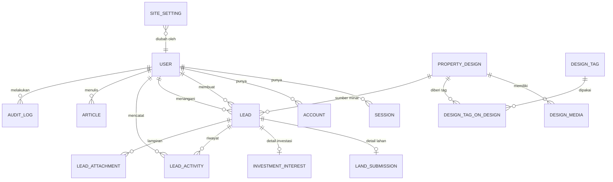

# 04 — Model Data & Skema Prisma

> Kembali ke [index](./README.md) · Sebelumnya: [03](./03-arsitektur-teknis.md) · Berikutnya: [05](./05-spesifikasi-api.md)

---

## 1. Prinsip pemodelan

1. **Lead adalah pusat data.** Ketiga aliran bisnis bermuara ke satu tabel `Lead`, dengan tabel detail terpisah per tipe (`LandSubmission`, `InvestmentInterest`). Ini membuat antrean sales tunggal dan pelaporan lintas aliran.
2. **Soft delete untuk konten.** Desain dan artikel yang sudah tayang tidak dihapus fisik; gunakan `status = ARCHIVED` + `deletedAt`.
3. **Data pribadi seminimal mungkin.** Hanya field yang benar-benar dipakai sales. Tidak ada NIK, nomor kartu, atau dokumen identitas pada MVP.
4. **Semua waktu dalam UTC**, ditampilkan dalam `Asia/Jakarta`.
5. **Uang dalam rupiah utuh** (`BigInt`), tanpa desimal. Serialisasi API: string (lihat [05 §2.4](./05-spesifikasi-api.md#24-tipe-data-khusus)).

## 2. ERD



Relasi `Lead ↔ User` ada dua (pembuat dan penangan), karenanya memakai nama relasi eksplisit di Prisma.

## 3. Kamus data inti

### 3.1 `Lead`

| Kolom | Tipe | Null | Default | Keterangan |
|-------|------|:----:|---------|------------|
| `id` | text | ✗ | cuid | PK |
| `reference` | text | ✗ | — | Nomor manusiawi, mis. `AZT-LD-2610-A7K2Q`. Unik |
| `type` | enum | ✗ | — | `BUY_DESIGN` / `LAND_OFFER` / `INVEST` / `GENERAL` |
| `status` | enum | ✗ | `NEW` | Lihat [§3.6](#36-pipeline-status) |
| `priority` | enum | ✗ | `NORMAL` | `LOW`/`NORMAL`/`HIGH`/`URGENT` |
| `name` | text | ✗ | — | 2–80 karakter |
| `phone` | text | ✗ | — | Dinormalisasi `+62…` |
| `phoneNormalized` | text | ✗ | — | Digit saja (`62812…`), dipakai untuk deduplikasi |
| `email` | text | ✓ | — | Wajib untuk `INVEST` |
| `city` | text | ✓ | — | Kota pemohon (bukan selalu lokasi lahan) |
| `message` | text | ✓ | — | Maks 1000 karakter |
| `designId` | text | ✓ | — | Terisi untuk `BUY_DESIGN` |
| `source` | enum | ✗ | `WEBSITE` | Kanal asal |
| `landingPath` | text | ✓ | — | Path halaman saat submit |
| `referrerUrl` | text | ✓ | — | Referrer (di-truncate 500 char) |
| `utmSource` … `utmTerm` | text | ✓ | — | Atribusi kampanye |
| `ipHash` | text | ✓ | — | SHA-256(IP + salt), untuk anti-abuse. **Bukan** IP mentah |
| `userAgent` | text | ✓ | — | Maks 300 char |
| `userId` | text | ✓ | — | Bila pengunjung login (fase 2) |
| `assignedToId` | text | ✓ | — | Staf penanggung jawab |
| `estimatedValue` | bigint | ✓ | — | Estimasi nilai deal (diisi sales) |
| `lostReason` | text | ✓ | — | Wajib saat status `LOST` |
| `firstContactedAt` | timestamptz | ✓ | — | Diisi otomatis saat status pertama kali ≥ `CONTACTED` |
| `lastContactedAt` | timestamptz | ✓ | — | Dari aktivitas tipe kontak |
| `nextFollowUpAt` | timestamptz | ✓ | — | Pengingat manual |
| `closedAt` | timestamptz | ✓ | — | Saat `WON`/`LOST` |
| `spamScore` | int | ✗ | 0 | Akumulasi sinyal (honeypot=100, waktu isi < 3 s=40, dsb.) |
| `idempotencyKey` | text | ✓ | — | Unik; mencegah duplikat saat submit diulang (lihat [05 §2.5](./05-spesifikasi-api.md#25-idempotensi--deduplikasi)) |
| `createdAt` / `updatedAt` | timestamptz | ✗ | now | — |

**Index:** `(status, createdAt)`, `(type, status)`, `(assignedToId, status)`, `(phoneNormalized)`, `(createdAt)`, `(designId)`.

### 3.2 `LandSubmission` (1:1 dengan Lead)

| Kolom | Tipe | Null | Keterangan |
|-------|------|:----:|------------|
| `id` | text | ✗ | PK |
| `leadId` | text | ✗ | Unik, FK ke `Lead` |
| `address` | text | ✗ | Alamat lengkap (10–300) |
| `province` / `city` / `district` | text | ✗/✗/✓ | Wilayah |
| `areaM2` | int | ✗ | 50–1.000.000 |
| `frontageM` | int | ✓ | Lebar depan (meter) |
| `ownershipStatus` | enum | ✗ | `SHM`/`SHGB`/`AJB`/`GIRIK`/`LETTER_C`/`OTHER` |
| `certificateOnBehalf` | text | ✓ | Atas nama siapa |
| `zoning` | text | ✓ | Peruntukan (perumahan, komersial, dll.) |
| `currentUse` | text | ✓ | Kondisi saat ini (kosong, bangunan, sawah) |
| `roadAccess` | text | ✓ | Lebar jalan/akses |
| `estimatedValue` | bigint | ✓ | Perkiraan harga lahan |
| `expectedScheme` | enum | ✗ | `BAGI_HASIL`/`SEWA`/`JUAL`/`BELUM_TAHU` |
| `startTimeline` | enum | ✓ | `IMMEDIATE`/`M3_6`/`M6_12`/`OVER_12`/`UNKNOWN` |
| `notes` | text | ✓ | Maks 1000 |

### 3.3 `InvestmentInterest` (1:1 dengan Lead)

| Kolom | Tipe | Null | Keterangan |
|-------|------|:----:|------------|
| `id` | text | ✗ | PK |
| `leadId` | text | ✗ | Unik |
| `budgetRange` | enum | ✗ | `UNDER_500M`/`M500_1B`/`B1_5`/`B5_20`/`ABOVE_20B` |
| `preferredLocations` | text[] | ✗ | Maks 5 kota |
| `horizonMonths` | int | ✓ | 6–60 |
| `riskProfile` | enum | ✗ | `CONSERVATIVE`/`MODERATE`/`AGGRESSIVE`/`UNKNOWN` |
| `instrument` | enum | ✓ | `EQUITY`/`PROFIT_SHARE`/`FIXED_RETURN`/`OPEN` |
| `notes` | text | ✓ | Maks 1000 |

### 3.4 `PropertyDesign`

| Kolom | Tipe | Null | Keterangan |
|-------|------|:----:|------------|
| `id` | text | ✗ | PK |
| `slug` | text | ✗ | Unik, `kebab-case`, 3–80 |
| `title` | text | ✗ | 5–120 |
| `subtitle` | text | ✓ | Maks 160 |
| `description` | text | ✗ | Markdown, maks 10.000 |
| `category` | enum | ✗ | `RESIDENTIAL`/`COMMERCIAL`/`RENOVATION`/`INTERIOR` |
| `style` | text | ✗ | Mis. `Minimalis`, `Modern Tropis`, `Skandinavia` |
| `floors` | int | ✗ | 1–4 |
| `bedrooms` | int | ✗ | 0–10 |
| `bathrooms` | int | ✗ | 0–10 |
| `carports` | int | ✗ | 0–5 |
| `buildingAreaM2` | int | ✗ | 20–5.000 |
| `landAreaMinM2` | int | ✗ | 20–100.000 |
| `estimatedBuildCostMin` | bigint | ✓ | Rupiah |
| `estimatedBuildCostMax` | bigint | ✓ | Rupiah |
| `priceFrom` | bigint | ✓ | Harga paket desain mulai dari |
| `status` | enum | ✗ | `DRAFT`/`PUBLISHED`/`ARCHIVED` |
| `featured` | bool | ✗ | Tampil di beranda |
| `viewCount` | int | ✗ | 0 |
| `publishedAt` | timestamptz | ✓ | Diisi saat publish |
| `seoTitle` / `seoDescription` | text | ✓ | Fallback ke `title`/`subtitle` |
| `deletedAt` | timestamptz | ✓ | Soft delete |

### 3.5 `Article`, `Faq`, `Testimonial`, `SiteSetting`

| Entitas | Field kunci |
|---------|-------------|
| `Article` | `slug`, `title`, `excerpt`, `content` (Markdown), `coverImageUrl`, `authorId`, `status`, `publishedAt`, `readingMinutes`, `tags text[]`, `viewCount`, `seoTitle`, `seoDescription`, `deletedAt` |
| `Faq` | `question`, `answer`, `category`, `sortOrder`, `isActive` |
| `Testimonial` | `name`, `role`, `projectName`, `quote`, `avatarUrl`, `isPublished`, `sortOrder` |
| `SiteSetting` | `key` (PK), `value` (JSONB), `updatedById`, `updatedAt` |

Kunci `SiteSetting` yang dipakai MVP:

| Key | Isi |
|-----|-----|
| `contact` | `{ phone, whatsapp, email, address, mapsUrl, operatingHours }` |
| `hero` | `{ title, subtitle, ctaLabel, ctaHref, imageUrl }` |
| `offer.land` | `{ headline, schemeBullets[], steps[], faqs[] }` |
| `offer.invest` | `{ headline, highlights[], riskNotes[], faqs[] }` |
| `wa.templates` | `{ design, land, invest, followUp }` |
| `analytics` | `{ ga4Id, umamiId, metaPixelId }` |
| `seo.default` | `{ titleTemplate, defaultDescription, ogImageUrl }` |

### 3.6 Pipeline status

```text
NEW ──► CONTACTED ──► QUALIFIED ──► PROPOSAL ──► NEGOTIATION ──► WON
 │           │             │             │             │
 └───────────┴─────────────┴─────────────┴─────────────┴──────► LOST
 (dari status mana pun kecuali WON/LOST)

SPAM: hanya dari NEW atau CONTACTED, oleh admin
```

Transisi yang diizinkan (divalidasi server):

| Dari | Ke |
|------|-----|
| `NEW` | `CONTACTED`, `LOST`, `SPAM` |
| `CONTACTED` | `QUALIFIED`, `LOST`, `SPAM` |
| `QUALIFIED` | `PROPOSAL`, `LOST` |
| `PROPOSAL` | `NEGOTIATION`, `QUALIFIED`, `WON`, `LOST` |
| `NEGOTIATION` | `WON`, `LOST` |
| `WON` | — (final) |
| `LOST` | `NEW` (reaktivasi, tercatat di aktivitas) |
| `SPAM` | `NEW` (bila salah klasifikasi) |

## 4. Skema Prisma lengkap

> **Prisma 7.** Sejak v7, `url` tidak lagi ditulis di blok `datasource`; URL koneksi dipindahkan ke `prisma.config.ts` dan `PrismaClient` memakai driver adapter. Bila memakai Prisma 6, tambahkan `url = env("DATABASE_URL")` di `datasource`, ubah provider generator menjadi `prisma-client-js`, dan adapter tidak diperlukan.

```ts
// packages/db/prisma.config.ts
import 'dotenv/config';
import { defineConfig, env } from 'prisma/config';

export default defineConfig({
  schema: 'prisma/schema.prisma',
  migrations: {
    path: 'prisma/migrations',
    seed: 'bun prisma/seed.ts',
  },
  datasource: {
    url: env('DATABASE_URL'),
  },
});
```

```prisma
generator client {
  provider = "prisma-client"
  output   = "../src/generated/prisma"
}

datasource db {
  provider = "postgresql"
}

// ============================================================
// Better Auth
// ============================================================

model User {
  id            String    @id
  name          String
  email         String    @unique
  emailVerified Boolean   @default(false)
  image         String?
  createdAt     DateTime  @default(now())
  updatedAt     DateTime  @updatedAt

  // admin plugin
  role       String    @default("customer")
  banned     Boolean   @default(false)
  banReason  String?
  banExpires DateTime?

  // profil aplikasi
  phone       String?
  whatsapp    String?
  city        String?
  company     String?
  lastLoginAt DateTime?

  sessions      Session[]
  accounts      Account[]
  createdLeads  Lead[]           @relation("LeadCreatedBy")
  assignedLeads Lead[]           @relation("LeadAssignee")
  activities    LeadActivity[]
  attachments   LeadAttachment[] @relation("AttachmentUploader")
  articles      Article[]        @relation("ArticleAuthor")
  auditLogs     AuditLog[]
  settings      SiteSetting[]    @relation("SettingUpdatedBy")

  @@index([role])
  @@map("user")
}

model Session {
  id             String   @id
  token          String   @unique
  expiresAt      DateTime
  ipAddress      String?
  userAgent      String?
  userId         String
  impersonatedBy String?
  createdAt      DateTime @default(now())
  updatedAt      DateTime @updatedAt

  user User @relation(fields: [userId], references: [id], onDelete: Cascade)

  @@index([userId])
  @@map("session")
}

model Account {
  id                    String    @id
  accountId             String
  providerId            String
  userId                String
  accessToken           String?
  refreshToken          String?
  idToken               String?
  accessTokenExpiresAt  DateTime?
  refreshTokenExpiresAt DateTime?
  scope                 String?
  password              String?
  createdAt             DateTime  @default(now())
  updatedAt             DateTime  @updatedAt

  user User @relation(fields: [userId], references: [id], onDelete: Cascade)

  @@index([userId])
  @@map("account")
}

model Verification {
  id         String   @id
  identifier String
  value      String
  expiresAt  DateTime
  createdAt  DateTime @default(now())
  updatedAt  DateTime @updatedAt

  @@index([identifier])
  @@map("verification")
}

// ============================================================
// Katalog desain
// ============================================================

enum DesignCategory {
  RESIDENTIAL
  COMMERCIAL
  RENOVATION
  INTERIOR
}

enum DesignStatus {
  DRAFT
  PUBLISHED
  ARCHIVED
}

enum MediaKind {
  IMAGE
  FLOOR_PLAN
  RENDER_3D
  VIDEO
}

model PropertyDesign {
  id          String  @id @default(cuid())
  slug        String  @unique
  title       String
  subtitle    String?
  description String  @db.Text

  category       DesignCategory
  style          String
  floors         Int    @default(1)
  bedrooms       Int    @default(0)
  bathrooms      Int    @default(0)
  carports       Int    @default(0)
  buildingAreaM2 Int
  landAreaMinM2  Int

  estimatedBuildCostMin BigInt?
  estimatedBuildCostMax BigInt?
  priceFrom             BigInt?

  status      DesignStatus @default(DRAFT)
  featured    Boolean      @default(false)
  viewCount   Int          @default(0)
  publishedAt DateTime?
  seoTitle       String?
  seoDescription String?

  createdAt DateTime  @default(now())
  updatedAt DateTime  @updatedAt
  deletedAt DateTime?

  media PropertyDesignMedia[]
  tags  DesignTagOnDesign[]
  leads Lead[]

  @@index([status, publishedAt])
  @@index([category, style])
  @@index([featured, status])
  @@index([deletedAt])
  @@map("property_design")
}

model PropertyDesignMedia {
  id         String    @id @default(cuid())
  designId   String
  kind       MediaKind @default(IMAGE)
  storageKey String
  url        String
  alt        String?
  width      Int?
  height     Int?
  sortOrder  Int       @default(0)
  isCover    Boolean   @default(false)
  createdAt  DateTime  @default(now())

  design PropertyDesign @relation(fields: [designId], references: [id], onDelete: Cascade)

  @@index([designId, sortOrder])
  @@map("property_design_media")
}

model DesignTag {
  id   String @id @default(cuid())
  slug String @unique
  name String @unique

  designs DesignTagOnDesign[]

  @@map("design_tag")
}

model DesignTagOnDesign {
  designId String
  tagId    String

  design PropertyDesign @relation(fields: [designId], references: [id], onDelete: Cascade)
  tag    DesignTag      @relation(fields: [tagId], references: [id], onDelete: Cascade)

  @@id([designId, tagId])
  @@index([tagId])
  @@map("design_tag_on_design")
}

// ============================================================
// Lead & CRM
// ============================================================

enum LeadType {
  BUY_DESIGN
  LAND_OFFER
  INVEST
  GENERAL
}

enum LeadStatus {
  NEW
  CONTACTED
  QUALIFIED
  PROPOSAL
  NEGOTIATION
  WON
  LOST
  SPAM
}

enum LeadPriority {
  LOW
  NORMAL
  HIGH
  URGENT
}

enum LeadSource {
  WEBSITE
  ORGANIC_SEARCH
  SOCIAL
  ADS
  REFERRAL
  WHATSAPP
  EVENT
  OTHER
}

enum ActivityType {
  NOTE
  STATUS_CHANGE
  ASSIGNMENT
  CALL
  WHATSAPP
  EMAIL
  MEETING
  SYSTEM
}

enum AttachmentKind {
  LAND_PHOTO
  DOCUMENT
  OTHER
}

enum OwnershipStatus {
  SHM
  SHGB
  AJB
  GIRIK
  LETTER_C
  OTHER
}

enum ExpectedScheme {
  BAGI_HASIL
  SEWA
  JUAL
  BELUM_TAHU
}

enum StartTimeline {
  IMMEDIATE
  M3_6
  M6_12
  OVER_12
  UNKNOWN
}

enum BudgetRange {
  UNDER_500M
  M500_1B
  B1_5
  B5_20
  ABOVE_20B
}

enum RiskProfile {
  CONSERVATIVE
  MODERATE
  AGGRESSIVE
  UNKNOWN
}

enum InvestmentInstrument {
  EQUITY
  PROFIT_SHARE
  FIXED_RETURN
  OPEN
}

model Lead {
  id        String     @id @default(cuid())
  reference String     @unique
  type      LeadType
  status    LeadStatus @default(NEW)
  priority  LeadPriority @default(NORMAL)

  name            String
  phone           String
  phoneNormalized String
  email           String?
  city            String?
  message         String? @db.Text

  designId String?
  design   PropertyDesign? @relation(fields: [designId], references: [id], onDelete: SetNull)

  source       LeadSource @default(WEBSITE)
  landingPath  String?
  referrerUrl  String?
  utmSource    String?
  utmMedium    String?
  utmCampaign  String?
  utmContent   String?
  utmTerm      String?
  ipHash       String?
  userAgent    String?

  userId       String?
  user         User?   @relation("LeadCreatedBy", fields: [userId], references: [id], onDelete: SetNull)
  assignedToId String?
  assignedTo   User?   @relation("LeadAssignee", fields: [assignedToId], references: [id], onDelete: SetNull)

  estimatedValue   BigInt?
  lostReason       String?
  firstContactedAt DateTime?
  lastContactedAt  DateTime?
  nextFollowUpAt   DateTime?
  closedAt         DateTime?
  spamScore        Int       @default(0)
  idempotencyKey   String?   @unique

  createdAt DateTime  @default(now())
  updatedAt DateTime  @updatedAt
  deletedAt DateTime?

  landSubmission     LandSubmission?
  investmentInterest InvestmentInterest?
  activities         LeadActivity[]
  attachments        LeadAttachment[]

  @@index([status, createdAt])
  @@index([type, status])
  @@index([assignedToId, status])
  @@index([phoneNormalized])
  @@index([createdAt])
  @@index([designId])
  @@index([deletedAt])
  @@map("lead")
}

model LandSubmission {
  id      String @id @default(cuid())
  leadId  String @unique
  address String

  province String
  city     String
  district String?

  areaM2            Int
  frontageM         Int?
  ownershipStatus   OwnershipStatus
  certificateOnBehalf String?
  zoning            String?
  currentUse        String?
  roadAccess        String?
  estimatedValue    BigInt?
  expectedScheme    ExpectedScheme
  startTimeline     StartTimeline?
  notes             String? @db.Text

  createdAt DateTime @default(now())
  updatedAt DateTime @updatedAt

  lead Lead @relation(fields: [leadId], references: [id], onDelete: Cascade)

  @@index([province, city])
  @@map("land_submission")
}

model InvestmentInterest {
  id        String @id @default(cuid())
  leadId    String @unique
  budgetRange       BudgetRange
  preferredLocations String[]
  horizonMonths     Int?
  riskProfile       RiskProfile @default(UNKNOWN)
  instrument        InvestmentInstrument?
  notes             String? @db.Text

  createdAt DateTime @default(now())
  updatedAt DateTime @updatedAt

  lead Lead @relation(fields: [leadId], references: [id], onDelete: Cascade)

  @@map("investment_interest")
}

model LeadActivity {
  id     String       @id @default(cuid())
  leadId String
  type   ActivityType
  body   String?      @db.Text
  meta   Json?

  actorId String?
  actor   User?   @relation(fields: [actorId], references: [id], onDelete: SetNull)

  createdAt DateTime @default(now())

  lead Lead @relation(fields: [leadId], references: [id], onDelete: Cascade)

  @@index([leadId, createdAt])
  @@index([actorId, createdAt])
  @@map("lead_activity")
}

model LeadAttachment {
  id         String         @id @default(cuid())
  leadId     String
  kind       AttachmentKind @default(LAND_PHOTO)
  fileName   String
  storageKey String
  mimeType   String
  sizeBytes  Int
  createdAt  DateTime       @default(now())

  uploadedById String?
  uploadedBy   User?   @relation("AttachmentUploader", fields: [uploadedById], references: [id], onDelete: SetNull)

  lead Lead @relation(fields: [leadId], references: [id], onDelete: Cascade)

  @@index([leadId])
  @@map("lead_attachment")
}

// ============================================================
// Konten
// ============================================================

enum ArticleStatus {
  DRAFT
  PUBLISHED
  ARCHIVED
}

model Article {
  id            String        @id @default(cuid())
  slug          String        @unique
  title         String
  excerpt       String?
  content       String        @db.Text
  coverImageUrl String?
  status        ArticleStatus @default(DRAFT)
  publishedAt   DateTime?
  readingMinutes Int?
  tags          String[]
  viewCount     Int           @default(0)
  seoTitle      String?
  seoDescription String?

  authorId String?
  author   User?   @relation("ArticleAuthor", fields: [authorId], references: [id], onDelete: SetNull)

  createdAt DateTime  @default(now())
  updatedAt DateTime  @updatedAt
  deletedAt DateTime?

  @@index([status, publishedAt])
  @@index([deletedAt])
  @@map("article")
}

model Faq {
  id        String  @id @default(cuid())
  question  String
  answer    String  @db.Text
  category  String  @default("umum")
  sortOrder Int     @default(0)
  isActive  Boolean @default(true)

  createdAt DateTime @default(now())
  updatedAt DateTime @updatedAt

  @@index([category, sortOrder])
  @@map("faq")
}

model Testimonial {
  id          String  @id @default(cuid())
  name        String
  role        String?
  projectName String?
  quote       String  @db.Text
  avatarUrl   String?
  isPublished Boolean @default(false)
  sortOrder   Int     @default(0)

  createdAt DateTime @default(now())
  updatedAt DateTime @updatedAt

  @@map("testimonial")
}

model SiteSetting {
  key   String @id
  value Json

  updatedById String?
  updatedBy   User?   @relation("SettingUpdatedBy", fields: [updatedById], references: [id], onDelete: SetNull)

  updatedAt DateTime @updatedAt

  @@map("site_setting")
}

// ============================================================
// Operasional
// ============================================================

model AuditLog {
  id         String   @id @default(cuid())
  action     String
  entityType String
  entityId   String
  before     Json?
  after      Json?
  ipHash     String?

  actorId String?
  actor   User?   @relation(fields: [actorId], references: [id], onDelete: SetNull)

  createdAt DateTime @default(now())

  @@index([entityType, entityId])
  @@index([actorId, createdAt])
  @@map("audit_log")
}

model FunnelEvent {
  id        String   @id @default(cuid())
  name      String
  path      String
  designId  String?
  leadId    String?
  sessionId String?
  props     Json?
  createdAt DateTime @default(now())

  @@index([name, createdAt])
  @@index([designId])
  @@index([leadId])
  @@map("funnel_event")
}
```

### 4.1 Inisialisasi Prisma Client

```ts
// apps/api/src/lib/prisma.ts
import { PrismaPg } from '@prisma/adapter-pg';
import { PrismaClient } from '@azetta/db';
import { env } from '../env';

const adapter = new PrismaPg({ connectionString: env.DATABASE_URL });

export const prisma = new PrismaClient({ adapter });
```

Klien dibuat sekali per proses (singleton) dan hanya diimpor oleh `apps/api`. Frontend tidak pernah mengimpor `@azetta/db`.

## 5. Index & pencarian

1. **Pencarian teks katalog** memakai `pg_trgm` (bukan `LIKE '%…%'` polos, yang tidak memakai index):

```sql
CREATE EXTENSION IF NOT EXISTS pg_trgm;
CREATE INDEX IF NOT EXISTS property_design_title_trgm
  ON property_design USING gin (title gin_trgm_ops);
CREATE INDEX IF NOT EXISTS property_design_style_trgm
  ON property_design USING gin (style gin_trgm_ops);
```

Migration ini dibuat manual (`prisma migrate dev --create-only`) karena bukan bagian dari DSL Prisma.

2. **Filter katalog** dilayani index komposit `(status, published_at)` + `(category, style)`.
3. **Daftar lead** memakai `(status, created_at DESC)`; filter assignee memakai `(assigned_to_id, status)`.
4. **Dedup nomor** memakai `phone_normalized` (B-tree) dalam rentang 24 jam.

Target awal: query daftar < 100 ms pada 50.000 lead.

## 6. Aturan integritas di level aplikasi

Beberapa aturan tidak dapat dinyatakan di Prisma, jadi ditegakkan di service layer + test:

| Aturan | Penegakan |
|--------|-----------|
| `LAND_OFFER` wajib punya `LandSubmission` | Transaksi DB: buat `Lead` + detail dalam satu `$transaction` |
| `INVEST` wajib punya `InvestmentInterest` dan `email` | Validasi skema + transaksi |
| `BUY_DESIGN` wajib `designId` yang `PUBLISHED` | Cek sebelum insert |
| `status = LOST` wajib `lostReason` | Validasi service |
| `publishedAt` terisi bila `PUBLISHED` | Hook service `publish()` |
| Hanya satu cover per desain | Service menormalkan `isCover` |
| `slug` unik & `kebab-case` | Validasi + unique index |
| Nomor telepon valid Indonesia | Normalisasi + regex |

## 7. Retensi & pembersihan data

| Data | Retensi | Aksi |
|------|---------|------|
| Lead `WON`/`LOST` | 24 bulan sejak `closedAt` | Anonimkan `name`, `phone`, `email`, `message`; pertahankan agregat |
| Lead `SPAM` | 90 hari | Hapus permanen |
| Lead `NEW` tanpa aktivitas | Tidak dihapus | Masuk laporan "stale" setelah 24 jam |
| Lampiran lead | Mengikuti lead | Hapus objek storage saat lead dianonimkan |
| `FunnelEvent` | 13 bulan | Agregasi bulanan disimpan, event mentah dihapus |
| `AuditLog` | 24 bulan | Hapus |
| `Session` kedaluwarsa | 30 hari setelah `expiresAt` | Hapus |
| Log aplikasi | 30 hari | Rotasi platform |

Job retensi berjalan harian pukul 03.00 WIB dan mencatat jumlah baris terdampak ke log.

## 8. Seed data

`packages/db/prisma/seed.ts` mengisi:

| Data | Jumlah | Catatan |
|------|--------|---------|
| Pengguna admin | 2 | `super_admin@azetta.id`, `sales@azetta.id` (kata sandi dari env, wajib diganti saat deploy) |
| Desain | 12 | 8 residential, 2 commercial, 2 renovation; media placeholder dari `packages/db/seed-assets` |
| Tag | 8 | Minimalis, Modern, Tropis, Skandinavia, Industrial, Klasik, Kecil, Mewah |
| Artikel | 4 | Draf contoh |
| FAQ | 10 | Tersebar di kategori umum/lahan/investasi |
| Testimoni | 3 | Fiktif, ditandai `isPublished=false` |
| SiteSetting | 7 kunci | Nilai default |

Seed **idempoten** (`upsert` berdasarkan slug/email) agar aman dijalankan berulang.

## 9. Strategi migrasi

| Aturan | Detail |
|--------|--------|
| Penamaan | `YYYYMMDDHHMMSS_deskripsi_singkat` (bawaan Prisma) |
| Review | Migrasi dibuat dengan `--create-only`, direview sebelum dijalankan |
| Produksi | `prisma migrate deploy` dijalankan sebagai langkah CI sebelum rilis |
| Perubahan destruktif | Wajib 2 langkah: (1) tambah kolom baru + backfill, (2) hapus kolom lama di rilis berikutnya |
| Rollback | Tidak ada down-migration otomatis; rollback = restore snapshot + deploy versi sebelumnya |
| Shadow DB | Dibutuhkan saat `migrate dev`; disediakan Postgres lokal |
| Data seed produksi | Hanya pembuatan akun admin pertama melalui skrip CLI, bukan seed penuh |

## 10. Kapasitas & pertumbuhan

| Tabel | Volume 12 bulan (estimasi) | Dampak |
|-------|----------------------------|--------|
| `lead` | 1.000–3.000 | Kecil; index cukup |
| `lead_activity` | 10.000–30.000 | Kecil |
| `lead_attachment` | 3.000 | Metadata kecil; objek di R2 |
| `property_design` | 50–200 | Kecil |
| `property_design_media` | 1.000–4.000 | Kecil |
| `funnel_event` | 500.000–2.000.000 | Terbesar; wajib retensi 13 bulan + index `(name, created_at)` |

Bila `funnel_event` tumbuh di luar kendali, pindahkan ke tabel partisi bulanan atau kirim langsung ke alat analitik tanpa menyimpan di DB.
